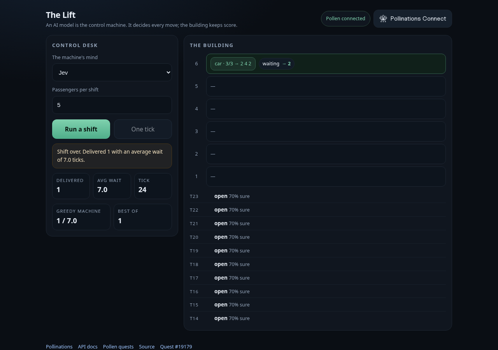

# The Lift

[](https://pollinations.ai)

An AI model is the control machine for a six-floor building. Every tick it answers one typed choice question through `POST /alpha/decisions` (up, down, open, hold) and the building does the rest: riders board, ride and leave on the floors the model chooses.

You watch, and afterwards you can compare the model's shift against a greedy controller that runs the same passenger script locally. Riders, capacity, travel and the shift clock are all resolved in code, so the model only makes the control decision.

- **Live:** https://marcus-mok-gh.github.io/the-lift/


- **Quest:** [#19179](https://github.com/pollinations/pollinations/issues/19179)

## Bring your own Pollen

Visitors pay for their own model calls. The page uses the Pollinations `polli-connect` widget:

```html
<polli-connect app-key="pk_..." budget="10" expiry="7" models="decision"></polli-connect>
```

The decision category is required: `POST /alpha/decisions` rejects keys without it. Run it locally by serving this folder over HTTP, with the page URL registered as a Redirect URI on the App Key.

## Design

The machine is not a chatbot wrapper: the model holds the controller role and nothing else. Every move is a calibrated choice with a probability spread, and the scoreboard exposes the difference between a language model running a building and a trivial program doing the same job.
